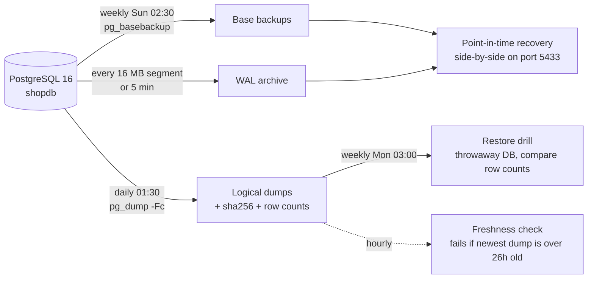

# pg-backup-recovery-lab

Backup and recovery for PostgreSQL 16 on AlmaLinux 9, built and tested on my own VM.

It covers nightly logical backups, weekly physical base backups, continuous WAL archiving, point-in-time recovery, automated restore drills, and a check that alerts when backups stop happening. Every restore time on this page was measured, not estimated.

## The problem it answers

Someone runs `DELETE FROM orders;` at 10:42. The last nightly backup was at 01:30. How do you get back every order up to 10:41:59, including the ones placed this morning? And how long will it take?

`pg_dump` alone can't answer that. This lab can.

## How it fits together



| Layer | Tool | What it gives you |
|---|---|---|
| Logical backup | `pg_dump -Fc` | Restore one table or one database, move data between versions |
| Physical backup | `pg_basebackup` | Fast restore of the whole cluster |
| WAL archiving | `archive_command` | Every change since the base backup, so you can recover to any second |
| Restore drill | `pg_restore` into a scratch DB | Proof that the backup actually restores, plus a measured restore time |
| Freshness check | file age vs a limit | Catches the most common failure: the job quietly stopped running |
| Scheduling | systemd timers | Logged runs, failures in `systemctl --failed`, catch-up after downtime |

## Results

Measured on my VM. Full tables in [`results/RESULTS.md`](results/RESULTS.md).

| | |
|---|---|
| RPO (worst-case data loss) | _filled in after Lab 04_ |
| RTO, single table (logical restore) | _filled in after Lab 02_ |
| RTO, whole cluster (PITR) | _filled in after Lab 04_ |

## Repo layout

| Path | What's in it |
|---|---|
| `scripts/pg_logical_backup.sh` | pg_dump per database, written to `.partial` and renamed on success, checksum, readability check, retention |
| `scripts/pg_base_backup.sh` | pg_basebackup, retention, removal of WAL no backup can use anymore |
| `scripts/restore_drill.sh` | Restores the newest dump into a throwaway DB, compares row counts, writes a markdown report |
| `scripts/pitr_restore.sh` | Point-in-time recovery into a separate data directory and port, never over the live server |
| `scripts/check_backup_freshness.sh` | Exits non-zero when any database's newest backup is too old |
| `scripts/common.sh` | Shared config loading, logging and Prometheus metric output |
| `systemd/` | Service and timer units for all of the above |
| `config/` | Example settings and the `postgresql.conf` archiving block |
| `sql/` | Sample shop schema, seed data (about 52k rows), live-traffic generator |
| `docs/CONCEPTS.md` | WAL, RPO/RTO, logical vs physical, timelines, why backups fail |
| `labs/` | Five step-by-step labs, each with a "break it" section |

## Running it

Work through the labs in order. Each one explains the idea, has you do it by hand, then runs the script:

1. [Install PostgreSQL 16 and load sample data](labs/01-install-and-seed.md)
2. [Logical backups and a real restore](labs/02-logical-backups.md)
3. [WAL archiving and base backups](labs/03-wal-archiving-and-base-backups.md)
4. [Point-in-time recovery: undo a DELETE run by mistake](labs/04-point-in-time-recovery.md)
5. [Automate with systemd and catch backups that stop](labs/05-automate-with-systemd.md)

Short version, once PostgreSQL is running with archiving on:

```bash
sudo git clone https://github.com/himu98/pg-backup-recovery-lab.git /opt/pg-backup-recovery-lab
sudo mkdir -p /etc/pg-backup /var/backups/postgres
sudo cp /opt/pg-backup-recovery-lab/config/backup.env.example /etc/pg-backup/backup.env
sudo chown postgres:postgres /var/backups/postgres

sudo -u postgres /opt/pg-backup-recovery-lab/scripts/pg_logical_backup.sh
sudo -u postgres /opt/pg-backup-recovery-lab/scripts/restore_drill.sh
```

## Design decisions

- **Dumps go to `.partial` first and are renamed only on success.** A dump interrupted halfway would otherwise sit in the folder looking like a valid backup.
- **Every dump has a sha256 file and a row-count file.** The drill checks both. A checksum proves the file wasn't damaged, and the row counts prove the restore holds the data it should.
- **PITR restores beside the live server, never over it.** While you're still working out what happened, overwriting production is the one move you can't take back.
- **The freshness check is separate from the backup job's exit code.** A job that never runs never fails, so it never shows up as an error. Only something that expects a backup and doesn't find one catches that.
- **Old WAL is cleaned up relative to the oldest kept base backup,** never by age alone. Deleting a WAL file that a kept backup still needs breaks the recovery chain without warning.

## Known limitations

- Backups live on the same VM as the database. That's the "2" of the 3-2-1 rule but not the "1": there's no offsite copy yet.
- The row counts are taken just before `pg_dump` starts, not inside its snapshot, so on a busy database the drill can report a small mismatch.
- No encryption at rest for the backup files.
- For production I'd look at pgBackRest or Barman, which handle parallel backups, incremental backups and offsite storage. This lab does it with the built-in tools on purpose, so every step is visible.

## Next

- Offsite copy of dumps and WAL to S3 or Google Cloud Storage
- Alerts through Prometheus: the scripts already write `pg_backup_stale`, `pg_restore_drill_seconds` and last-success timestamps when `METRICS_DIR` is set. That's the next project, `observability-stack`.

## License

MIT
